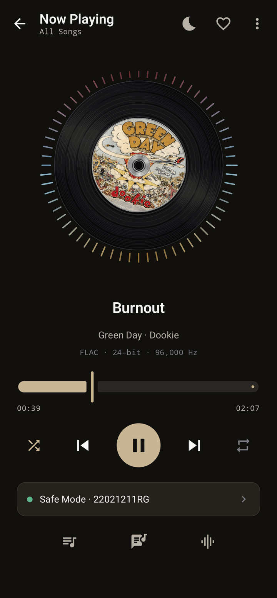
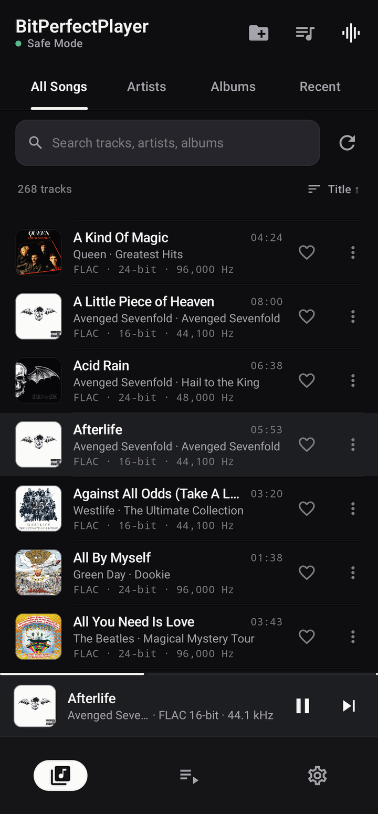
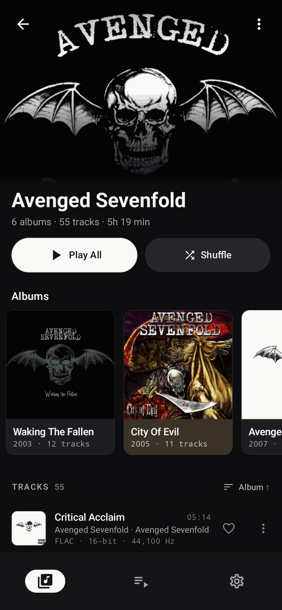
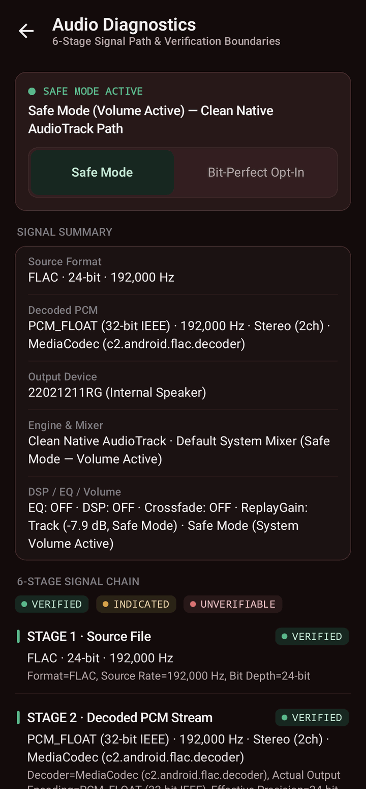
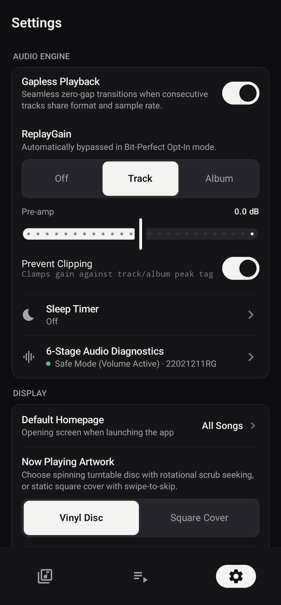
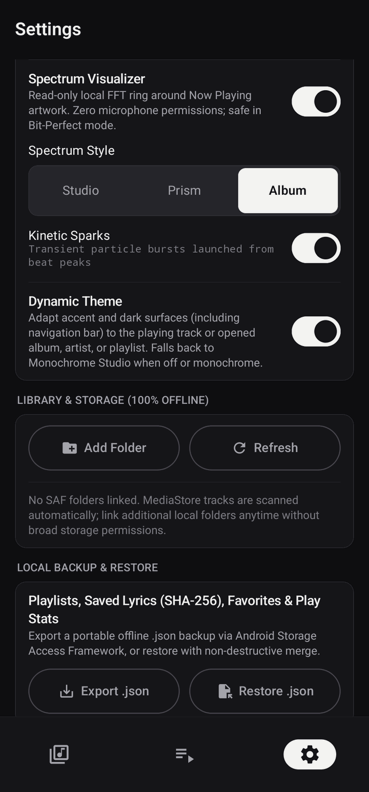
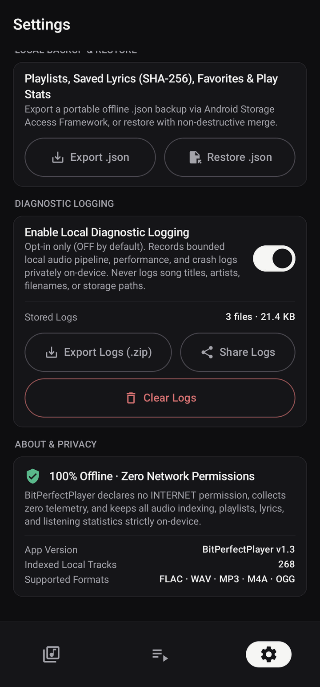
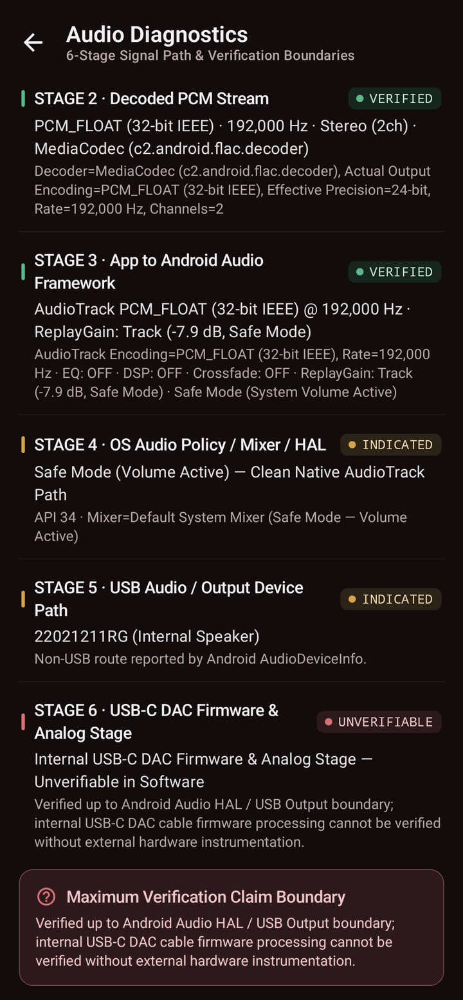

# BitPerfectPlayer

A 100% offline, local-first native Android music player (`com.cangkir.bitperfectplayer`) built with Kotlin and Jetpack Compose. Designed for clean digital PCM reproduction, runtime-adaptive Android 14+ USB DAC bit-perfect mixer negotiation, mandatory hearing protection for high-sensitivity in-ear monitors (IEMs), deterministic offline lyrics binding, and transparent 6-stage audio path diagnostics.

---

## Screenshots

<table>
  <tr>
    <td align="center" valign="top" width="25%">
      <br />
      <sub><b>Now Playing</b><br />Vinyl Disc, 24-bit/96 kHz, Radial Spectrum</sub>
    </td>
    <td align="center" valign="top" width="25%">
      <br />
      <sub><b>Library — All Songs</b><br />Audio Specs &amp; Compact MiniPlayer</sub>
    </td>
    <td align="center" valign="top" width="25%">
      <br />
      <sub><b>Artist Detail</b><br />Hero Banner &amp; Oldest-First Albums</sub>
    </td>
    <td align="center" valign="top" width="25%">
      <br />
      <sub><b>Audio Diagnostics (1/2)</b><br />Mode Selector &amp; Signal Summary</sub>
    </td>
  </tr>
  <tr>
    <td align="center" valign="top" width="25%">
      <br />
      <sub><b>Settings — Audio &amp; Display</b><br />Gapless, ReplayGain, Artwork Style</sub>
    </td>
    <td align="center" valign="top" width="25%">
      <br />
      <sub><b>Settings — Visuals &amp; Backup</b><br />Spectrum, Dynamic Theme, SAF</sub>
    </td>
    <td align="center" valign="top" width="25%">
      <br />
      <sub><b>Settings — Logs &amp; Privacy</b><br />Opt-In Logging &amp; 100% Offline</sub>
    </td>
    <td align="center" valign="top" width="25%">
      <br />
      <sub><b>Audio Diagnostics (2/2)</b><br />6-Stage Verification Boundaries</sub>
    </td>
  </tr>
</table>

---

## Core Design Principles

1. **100% Offline and Local-First:** Zero `INTERNET`, `RECORD_AUDIO`, `MANAGE_EXTERNAL_STORAGE`, `WRITE_EXTERNAL_STORAGE`, or `READ_MEDIA_IMAGES` permissions. No networking libraries, telemetry, analytics, ads, cloud sync, or online lookups.
2. **Hearing Safety First:** Defaults to **Safe Mode** (system volume active) on fresh installation and on every USB audio connection. **Bit-Perfect Opt-In** never auto-activates and requires an explicit safety confirmation dialog whenever hardware volume control is unverified.
3. **Honest Audio Diagnostics:** Clearly separates verified runtime state from OS-indicated metadata and unverifiable DAC hardware stages—never equating lossless decoding with verified bit-perfect output.
4. **Pure-Kotlin Domain Separation:** Core playback policies, DSP, WAV/artwork/tag/lyrics parsers, perceptual OKLCH color math, backup/playlist codecs, and diagnostic formatting are isolated in `android.*`-free Kotlin modules for deterministic JVM testing. For full architectural details, see [`SPEC.md`](SPEC.md) and [`DECISIONS.md`](DECISIONS.md).

---

## Highlights (`v1.4`)

- **OKLCH Multi-Color Dynamic Theme (`Subtle` & `Vibrant`):** Dependency-free, pure-Kotlin OKLCH center-weighted K-Means++ palette extraction with WCAG 2.1 contrast enforcement, persistent `Subtle` / `Vibrant` intensity toggle (included in offline `.json` backups), smooth root-hoisted theme transitions, and zero-blur GPU-friendly radial gradient ambient atmospheric glows behind `Now Playing` artwork and `Artist Detail` heroes.
- **Context-Aware 4-Slot Artwork Adaptation:** Dynamically extracts palettes from whichever artwork slot is actively displayed—`FRONT_COVER`, flipped `BACK_COVER`, circular Vinyl `DISC` label, or custom/embedded `ARTIST` portrait—automatically borrowing chromatic fallback art for monochrome artwork before reverting cleanly to Monochrome Studio.
- **Frequency-Mapped `Album` Spectrum & Multi-Color `Kinetic Sparks`:** Maps Bass, Mid, and Treble bands smoothly across the active cover's OKLCH palette (with high-amplitude peak highlights) across both the Vinyl radial ring and Square Cover linear strip, while beat-peak sparks inherit the exact color of their launching frequency band with zero per-frame allocations.
- **Modularized Audio/UI Architecture & Instrumentation Smoke Suite:** Cohesive decomposition across the audio engine, ViewModel coordinators, navigation chrome, and library views, paired with a real on-device `androidTest` instrumentation smoke suite.

---

## Features

### Audio Engine, Formats, & Hearing Safety

- **Supported Formats:** Lossless **FLAC (16/24-bit)** and **WAV (PCM 16/24-bit)**, plus lossy **MP3**, **M4A (AAC)**, and **OGG (Vorbis / Opus)**. *(Excludes DSD, ALAC, APE, WavPack, and `.cue` sheets.)*
- **Direct WAV & Raw FLAC PCM Paths:** Pure-Kotlin RIFF/WAV header parsing and direct PCM reading keep 24-bit WAV un-truncated (native 24/32-bit integer on API 31+; lossless 32-bit float on API 26–30). Compressed tracks decode through Android `MediaExtractor` + `MediaCodec` with runtime PCM format verification, and `audio/raw` streams bypass `c2.android.raw.decoder` directly to native integer/float PCM output.
- **Runtime-Adaptive Android 14+ USB Output:** On API 34+ with **Bit-Perfect Opt-In** active on a USB audio sink, queries supported USB mixer attributes to prefer `MIXER_BEHAVIOR_BIT_PERFECT` matching format and sample rate, or falls back honestly to native sample-rate `MIXER_BEHAVIOR_DEFAULT` (never claiming bit-perfect). In **Safe Mode**, playback stays unpinned with zero blocking mixer IPC and transparent AudioFlinger routing, automatically cleaning up preferred mixer attributes whenever returning to Safe Mode, stopping, or disconnecting USB.
- **Mandatory Hearing Protection (107 dB/mW IEMs):** Enforces Safe Mode on launch and USB plug-in, gates Bit-Perfect Opt-In behind an explicit fixed-full-scale warning dialog, isolates software volume scaling strictly to Safe Mode, and triggers immediate auto-pause on USB audio attach/detach, `ACTION_AUDIO_BECOMING_NOISY`, or output route changes.
- **Gapless Playback, Safe-Mode ReplayGain, & Sleep Timer:** Preloads matching consecutive tracks for seamless `AudioTrack` reuse without artificial crossfades; supports header-only Track/Album ReplayGain (FLAC, OGG Vorbis/Opus, MP3 ID3v2, M4A) strictly in Safe Mode (unconditionally bypassed in Bit-Perfect Opt-In); and provides a configurable sleep timer (`15–60 min` or `End of current track`) with Safe-Mode fade-out.

### 6-Stage Real-Time Audio Diagnostics & Opt-In Local Logging

Inspect the live playback pipeline across six explicit stages, each tagged `VERIFIED`, `INDICATED`, or `UNVERIFIABLE`:

1. **Source File** — Container, codec, sample rate (`Hz`), and bit depth.
2. **Decoded PCM** — Runtime PCM encoding, sample rate, and channel count.
3. **App-to-Framework** — Buffer path and ReplayGain state (`OFF`, active Safe-Mode dB, or `Bypassed (Bit-Perfect Opt-In)`).
4. **OS Audio Policy / Mixer / HAL** — Active mixer behavior (`BIT_PERFECT`, native sample-rate `DEFAULT`, or clean native fallback) and resampling status.
5. **USB Audio / Output Device Path** — Active output device and connection type.
6. **DAC Analog Conversion** — Internal DAC cable firmware and analog output stage (`UNVERIFIABLE`).

> Verified up to Android Audio HAL / USB Output boundary; internal USB-C DAC cable firmware processing cannot be verified without external hardware instrumentation.

An optional, **OFF-by-default** local diagnostic logger (`Settings -> DIAGNOSTIC LOGGING`) records bounded, rotated, PII-redacted technical events and crash stacks privately on-device with SAF `.zip` export, scoped `FileProvider` sharing, and one-tap clearing.

### Library, Multi-Artwork, Playlists, Lyrics, & Adaptive Visuals

- **Scoped Local Library & SAF Import:** Scans `MediaStore` while excluding messaging voice notes, call recordings, ringtones, alarms, notifications, and short clips, alongside persistable Storage Access Framework (SAF) folder/file imports and configurable **Default Homepage** selection.
- **Fluid Gesture Navigation & Adaptive Layouts:** Unifies top-level `[Library] <-> [Playlists] <-> [Settings]` and `[Content] <-> [Now Playing] <-> [Settings]` navigation via nested horizontal pagers with swipe-protected controls, horizontal swiping across all 6 Library sub-tabs (`All Songs`, `Artists`, `Albums`, `Recent`, `Favorites`, `Folders`), adaptive portrait bottom bar (`< 600.dp`) and wide/tablet side `NavigationRail` + 2-column `Now Playing` (`>= 600.dp`), and a compact 2-line `MiniPlayerBar` with swipe-up to open and swipe-left to dismiss.
- **Studio Artist Detail & Multi-Slot Local Artwork:** Unifies the `Artists` tab and `Artist Detail` hero behind a 4-tier artwork chain (offline zero-permission Photo Picker custom photo -> embedded `ARTIST` art -> oldest-first album cover -> Monochrome Studio monogram), paired with chronological oldest-first album carousels, uncropped `ContentScale.Fit` thumbnails (including `Folders` covers), lazy FLAC/MP3 `DISC` vinyl center labels, and on-demand `BACK_COVER` flipping on albums and Square Cover.
- **Queue, Playlists, `.m3u8`, & Offline Backup:** Passive read-only Queue inspection with scoped queue persistence, pure-Compose drag-and-drop track reordering (shared across Queue and Playlists), duplicate-track protection, undo snackbars, anti-skip fingerprint-bound play counts, `.m3u8` import/export, and non-destructive offline `.json` backup/restore of playlists, lyrics, favorites, stats, and display preferences.
- **Deterministic Offline Lyrics:** Binds `.lrc` and manual lyrics to deterministic SHA-256 content fingerprints (seekable head + tail + size hashing for large files) with fault-tolerant multi-encoding `.lrc` parsing, sibling auto-detection, SAF import, and playback-clock-synced highlighting.
- **Interactive Vinyl Turntable & Read-Only Spectrum Visualizer:** Switchable **Vinyl Disc** and **Square Cover** modes with GPU-accelerated rotation and Safe-Mode-only live varispeed/reverse scratching (completely bypassed in Bit-Perfect Opt-In), plus a zero-permission, read-only post-write FFT visualizer (`Studio`, `Prism`, and frequency-mapped `Album` styles + optional `Kinetic Sparks`).
- **Polished `MediaSession` & Android 17 Hardening:** Custom monochrome notification icon, automatic dark-letterboxed square artwork framing for non-square covers, concise audiophile format subtitles, `Favorite` and `Shuffle` custom actions, and foreground-service promotion gating for reliable background playback. *(SystemUI skins vary in how many custom media buttons they display on lock screens.)*

---

## Permissions and Privacy

Declared permissions in [`app/src/main/AndroidManifest.xml`](app/src/main/AndroidManifest.xml):

| Permission | Scope | Purpose |
| :--- | :--- | :--- |
| `MODIFY_AUDIO_SETTINGS` | Install-time | Required by Android 14+ `AudioManager.setPreferredMixerAttributes()` and `clearPreferredMixerAttributes()` |
| `READ_MEDIA_AUDIO` | API 33+ | Local MediaStore audio library discovery |
| `READ_EXTERNAL_STORAGE` | `maxSdkVersion="32"` | Local MediaStore audio discovery on Android 8.0–12L (API 26–32) |
| `FOREGROUND_SERVICE` | Install-time | Persistent background playback service |
| `FOREGROUND_SERVICE_MEDIA_PLAYBACK` | API 34+ | `mediaPlayback` foreground service compliance |
| `POST_NOTIFICATIONS` | API 33+ | Media playback control notification |

Strictly prohibited and verified absent from both source and merged manifests:
- `android.permission.INTERNET`
- `android.permission.MANAGE_EXTERNAL_STORAGE`
- `android.permission.WRITE_EXTERNAL_STORAGE`
- `android.permission.RECORD_AUDIO`
- `android.permission.READ_MEDIA_IMAGES`

---

## Architecture and Package Layout

```text
app/src/
|-- main/java/com/cangkir/bitperfectplayer/
|   |-- BitPerfectApplication.kt  # Dependency container, repository wiring, & foreground lifecycle tracking
|   |-- MainActivity.kt           # Single-activity Compose entry point & root Dynamic Theme host
|   |-- audio/                    # Decoders, modular AudioOutputEngine, USB mixer/route managers, safety, diagnostics, DSP
|   |-- data/                     # Room v5 database & migrations, DAOs, DataStore preferences, offline JSON backup codec
|   |-- diagnostics/              # Opt-in local diagnostic logging (redacted formatter, rotation, crash handler, ZIP exporter)
|   |-- library/                  # MediaStore/SAF scanning, embedded artwork/year parsers, artist/folder helpers, playlists, .m3u8
|   |-- lyrics/                   # Deterministic SHA-256 content fingerprinting, .lrc parser, local lyrics repository
|   `-- ui/                       # ViewModel coordinators, Queue, Lyrics, Diagnostics, & MiniPlayerBar
|       |-- library/              # LibraryScreen, ArtistDetailView, hero/albums/overflow, & tab lists (Artists/Albums/Folders)
|       |-- navigation/           # Adaptive NavigationBar/NavigationRail chrome, global overlays, root pager, & destinations
|       |-- nowplaying/           # Adaptive 1/2-pane NowPlayingScreen, Vinyl/Square controls, spectrum, & safety dialog
|       |-- playlists/            # PlaylistsScreen, overview, detail view, & dialogs
|       |-- settings/             # SettingsScreen & modular audio, display/library, backup, and logging sections
|       `-- theme/                # Monochrome Studio theme, pure-Kotlin OKLCH palette engine, 4-slot coordinator, & ambient glow
|-- test/                         # Pure-Kotlin JVM unit tests, Room migration tests, & Robolectric Compose UI tests
`-- androidTest/                  # On-device instrumentation smoke suite (launch, Room/DataStore, Compose UI)
```

Local persistence uses Room (`BitPerfectDatabase.kt`, schema `version = 5`, verified `MIGRATION_1_2` through `MIGRATION_4_5`) with seven local tables (`cached_tracks`, `lyrics`, `track_history`, `favorite_tracks`, `playlists`, `playlist_tracks`, `track_stats`) paired with Jetpack DataStore Preferences.

---

## Tech Stack and Build Requirements

- **Application ID / Namespace:** `com.cangkir.bitperfectplayer` (`versionName = "1.4"`, `versionCode = 5`)
- **SDK Levels:** `minSdk = 26` (Android 8.0), `compileSdk = 37`, `targetSdk = 37`
- **Toolchain:** Gradle Wrapper `9.9.1`, Gradle Daemon JVM `25`, Java Compatibility `JavaVersion.VERSION_11`
- **Core Stack:** Android Gradle Plugin `9.5.2`, Kotlin `2.4.21`, KSP `2.3.14`
- **Code Quality & Static Analysis (Build-Time Only):** `ktlint` Gradle plugin `14.2.0` (MIT, [`.editorconfig`](.editorconfig)) and `detekt` `2.0.0-alpha.6` (Apache 2.0, [`config/detekt/detekt.yml`](config/detekt/detekt.yml))
- **AndroidX & Libraries (Permissive Apache 2.0 / MIT Only; Zero FFmpeg, NDK, or GPL/LGPL):**
  - Jetpack Compose BOM `2026.09.00` (Material 3, UI, Material Icons Extended)
  - Navigation Compose `2.9.8`
  - Room `2.8.5` (`room-runtime`, `room-ktx`, `room-compiler`)
  - DataStore Preferences `1.1.7`, DocumentFile `1.1.0`
  - Lifecycle `2.9.4`, Activity Compose `1.10.1`, Core KTX `1.16.0`, Coroutines `1.10.2`
  - Testing: JUnit `4.13.2`, Coroutines Test `1.10.2`, Robolectric `4.18.1`, Compose UI Test JUnit4, AndroidX Espresso & Ext JUnit

---

## Building and Testing

### Prerequisites

- Android SDK with platform `android-37` installed (configured via `ANDROID_HOME` / `ANDROID_SDK_ROOT` or an untracked `local.properties` file).
- JDK 25 (or Gradle toolchain provisioning configured in `gradle/gradle-daemon-jvm.properties`).

### Common Commands

```bash
# Run Kotlin formatting (ktlint) and static analysis (detekt)
./gradlew ktlintCheck detekt

# Auto-format Kotlin sources according to .editorconfig
./gradlew ktlintFormat

# Run JVM unit tests, Room migration tests, and Robolectric Compose UI tests
./gradlew testDebugUnitTest

# Run Android Lint on the debug variant
./gradlew lintDebug

# Build debug, instrumentation test, and R8-optimized unsigned release APKs
./gradlew assembleDebug assembleDebugAndroidTest assembleRelease
```

To verify that no dependency merges forbidden permissions into debug or release manifests after building:

```bash
grep -E "INTERNET|RECORD_AUDIO|MANAGE_EXTERNAL_STORAGE|WRITE_EXTERNAL_STORAGE|READ_MEDIA_IMAGES" \
  app/build/intermediates/merged_manifest/debug/processDebugMainManifest/AndroidManifest.xml \
  app/build/intermediates/merged_manifest/release/processReleaseMainManifest/AndroidManifest.xml
```

(Should return no matches.)

### Side-by-Side Debug & Release Variants

| Variant | Application ID | Version Name | Launcher Label | Provider Authorities (`FileProvider` / Startup) |
| :--- | :--- | :--- | :--- | :--- |
| **`debug`** | `com.cangkir.bitperfectplayer.debug` | `<versionName>-dev` | **BitPerfect Dev** | `com.cangkir.bitperfectplayer.debug.*` |
| **`release`** | `com.cangkir.bitperfectplayer` | `<versionName>` | **BitPerfectPlayer** | `com.cangkir.bitperfectplayer.*` |

Debug builds install cleanly alongside the signed production release APK on the same device without signature or provider authority conflicts.

---

## Verification Scope and Hardware Safety Notice

- **Automated Software Verification:** Pure-Kotlin domain logic, deterministic audio coordination, Room `v1..v5` migrations, OKLCH palette extraction & multi-slot theming, spectrum/turntable DSP, backup/playlist codecs, Robolectric Compose UI behaviors, and an on-device `androidTest` smoke suite are verified alongside `ktlintCheck`, `detekt`, Android Lint, manifest privacy audits, and R8 release builds. See [`docs/HANDOFF_REPORT.md`](docs/HANDOFF_REPORT.md) for per-release verification logs.
- **Physical Hardware Limits:** Runtime behavior of `AudioManager.MIXER_BEHAVIOR_BIT_PERFECT` and `MIXER_BEHAVIOR_DEFAULT` sample-rate negotiation, Android 16 / OEM `audio/raw` and `MediaCodec` 24-bit output support, UAC hardware volume attenuation, internal USB-C DAC firmware processing, 120 Hz OLED rendering smoothness, and OEM SystemUI media notification slots depend on the target device's Android Audio HAL, SystemUI skin, and DAC hardware. The reference hardware profile used during specification is a POCO F4 (Android 14 / HyperOS) paired with a KZ EDX Pro 2 USB-C IEM (107 dB/mW at 24 ohms).
- **Safety Warning:** Before toggling **Bit-Perfect Opt-In** on an unfamiliar phone or USB-C DAC, keep high-sensitivity earphones out of your ears until you confirm whether volume buttons attenuate output or the DAC plays at fixed 100% full scale.

---

## Repository Documentation

- [`SPEC.md`](SPEC.md) -- Full product specification, locked audio architecture, and 6-stage verification contract
- [`DECISIONS.md`](DECISIONS.md) -- Architectural decisions and rationale log
- [`docs/TASKS.md`](docs/TASKS.md) -- MVP execution checklist
- [`docs/HANDOFF_REPORT.md`](docs/HANDOFF_REPORT.md) -- Build verification and implementation history report
- [`CONTRIBUTING.md`](CONTRIBUTING.md) -- Contribution guidelines, architectural invariants, and local verification steps
- [`SECURITY.md`](SECURITY.md) -- Security, privacy, and hearing-safety vulnerability reporting policy

---

## License

Copyright 2026 Endricho Folabessy.

Licensed under the Apache License, Version 2.0 (the "License"); you may not use this repository except in compliance with the License. You may obtain a copy of the License at `http://www.apache.org/licenses/LICENSE-2.0`, or see [`LICENSE`](LICENSE) and [`NOTICE`](NOTICE) in this repository.
